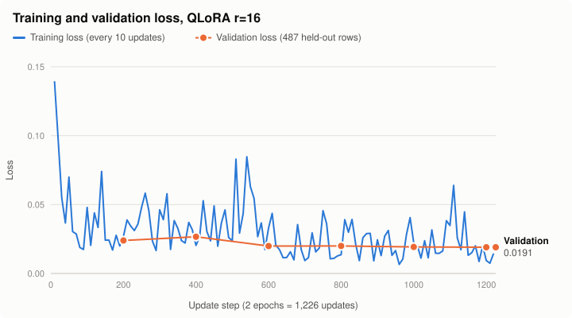

# ToolTuned

Fine-tuning `Qwen/Qwen2.5-1.5B-Instruct` with QLoRA to call functions more accurately, measured against the base model on the Berkeley Function Calling Leaderboard (BFCL).

## Setup

Requires Python 3.11. On Windows:

```bash
py -3.11 -m venv .venv
.venv\Scripts\activate
pip install -r requirements.txt
```

Set `HF_TOKEN` and `WANDB_API_KEY` as environment variables.

## Tests

```bash
python -m pytest
```

## Results

BFCL scores before and after fine-tuning, both on a T4 GPU with fp16. The fine-tuned model is a QLoRA adapter (r=16, 2 epochs on 10,000 examples) merged into the base model.

| Category | Questions | Base model | Fine-tuned | Change |
| --- | --- | --- | --- | --- |
| `simple_python` | 400 | 86.50% | 87.50% | +1.0 |
| `multiple` | 200 | 84.00% | 87.00% | +3.0 |
| `parallel` | 200 | 74.50% | 78.50% | +4.0 |
| `parallel_multiple` | 200 | 72.50% | 75.50% | +3.0 |
| `irrelevance` | 240 | 72.08% | 57.50% | −14.6 |

Raw scores: [`results/baseline/`](results/baseline/) and [`results/qlora_r16/`](results/qlora_r16/).

### Training



Training took 3 h 48 min on one T4. Validation loss on 487 held-out rows fell from 0.0240 at step 200 to 0.0191 and stayed flat over the last 400 updates, so the model did not overfit. The small rise at step 400 came while the learning rate was near its peak. The numbers come from the training log, saved in [`loss_history.json`](results/qlora_r16/loss_history.json); `python scripts/plot_loss.py results/qlora_r16` redraws the chart.

**What this shows:**

- **Tool calling improved slightly.** All four categories that need a tool call went up, most in the two parallel categories, where the model must make several calls. Each gain is small (4 to 8 more correct answers out of 200 or 400), close to run-to-run noise on its own, but all four moved the same way.
- **Knowing when not to call a tool got much worse.** In `irrelevance`, the right answer is no tool call, and the fine-tuned model wrongly called a tool on 35 more of the 240 questions.
- **Likely cause:** the training set's 1,000 no-tool examples pair a request with clearly unrelated tools, while BFCL's irrelevance questions are near misses: a tool on the same topic that can't actually answer. The model learned to call any tool that looks related.

These come from running BFCL with a custom model registration, because BFCL has no built-in Qwen2.5 entry, so they aren't official leaderboard results. The runs cover these five categories only. BFCL counts categories that weren't run as 0, so the overall accuracy columns in the CSV files understate both models and shouldn't be quoted.
