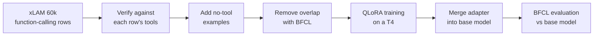

# ToolTuned

[](https://github.com/arsheen2244/tooltuned/actions/workflows/tests.yml)

Fine-tuning `Qwen/Qwen2.5-1.5B-Instruct` with QLoRA to call functions (tools) more accurately, and measuring it against the base model on the Berkeley Function Calling Leaderboard (BFCL), on a free Kaggle T4 GPU.

- **Model:** [huggingface.co/asheeee24/tooltuned-qwen2.5-1.5b](https://huggingface.co/asheeee24/tooltuned-qwen2.5-1.5b)
- **Demo:** [huggingface.co/spaces/asheeee24/tooltuned-demo](https://huggingface.co/spaces/asheeee24/tooltuned-demo) (recorded answers on five examples)
- **Full results:** [`results/RESULTS.md`](results/RESULTS.md)

## Findings

- **Tool calling improved.** The fine-tuned model scored higher than the base model on all four tool-calling categories, by 1.0 to 3.5 points. On the same 1,000 questions, it got 61 right that the base model missed, against 38 the other way (paired McNemar test, p = 0.027).
- **Knowing when *not* to call a tool got worse.** On `irrelevance` it fell from 72.50% to 57.92% (p < 0.001). The training data's no-tool examples paired requests with clearly unrelated tools, while BFCL's are near misses on the same topic. In a labelled sample of failures, 7 of 9 irrelevance errors were near-miss calls.
- **Verifying the training data did not help.** An ablation trained on unverified data scored *higher* on tool calling (36 vs 16 questions only one model got right, p = 0.008). Each model was trained once, so training luck is not ruled out.

## Results

BFCL accuracy on 5 categories (1,240 questions), on a T4 GPU in fp16. **Verified** is the QLoRA model trained on data that passed [`verify.py`](src/tooltuned/verify.py), and is the published model. **Unverified** is the same recipe on data without those checks.

| Category | Questions | Base | Verified | Unverified |
| --- | --- | --- | --- | --- |
| `simple_python` | 400 | 86.50% | 87.50% | 89.25% |
| `multiple` | 200 | 84.00% | 87.00% | 88.50% |
| `parallel` | 200 | 74.50% | 78.00% | 81.00% |
| `parallel_multiple` | 200 | 72.50% | 75.50% | 77.50% |
| `irrelevance` | 240 | 72.50% | 57.92% | 55.00% |

The trade shows in the failure counts: "didn't call a tool when it should" fell from 6 to 0, while "called a tool when it shouldn't" rose from 66 to 101. Re-running BFCL on the same model changed at most 1 question per category, so evaluation noise is small next to these differences.

[`results/RESULTS.md`](results/RESULTS.md) has every paired test, the failure types, a labelled sample of 20 failures and hypotheses for the ablation result. It is built by `python scripts/compare.py`.

These are not official leaderboard results. BFCL has no built-in Qwen2.5 entry, so [`scripts/bfcl_cli.py`](scripts/bfcl_cli.py) registers one that builds prompts with Qwen's chat template. BFCL counts categories that weren't run as 0, so the overall accuracy columns in its CSV files understate every model and shouldn't be quoted.

## How it works



**1. Data** (CPU, on a laptop). The 60,000 rows of [`Salesforce/xlam-function-calling-60k`](https://huggingface.co/datasets/Salesforce/xlam-function-calling-60k) are checked against their own tool definitions: the function and its parameters exist, required parameters are present, and the values match the declared types. 58,485 rows pass. 6,498 no-tool examples pair a request with clearly unrelated tools and a reply that declines to call them. Rows too close to any of the 1,240 BFCL test questions are removed, using character 8-grams: 4,036 tool-call and 400 no-tool rows. The training set is 10,000 rows (10% no-tool), plus 500 for validation. The counts are in [`results/data_report.json`](results/data_report.json).

**2. Training** (Kaggle T4). QLoRA: the base model loads in 4-bit, and a LoRA adapter (r = 16, alpha = 32) on all linear layers trains for 2 epochs in fp16, because the T4 has no bf16. Loss is computed only on the assistant's answer. The settings are in [`configs/qlora_r16.yaml`](configs/qlora_r16.yaml).


Training took 3 h 48 min. Validation loss on 487 held-out rows fell from 0.0240 at step 200 to 0.0191, and stayed flat over the last 400 updates, so the model did not overfit. The numbers are in [`loss_history.json`](results/tooltuned_verified/loss_history.json).

**3. Evaluation** (Kaggle T4). The adapter is merged into the base model, which is checked to make a correct tool call, then scored with `bfcl-eval` and vLLM in a separate Python 3.11 environment. Every model uses the same BFCL handler, prompt format and output parser.

## Limitations and next steps

- **Near-miss no-tool examples** are the most likely fix for the irrelevance drop: requests paired with tools on the same topic that can't answer them.
- **One training run per model.** Training each model again with a second seed (about 9 GPU hours for both) would show whether the ablation result is real or training luck.
- **Narrow evaluation:** 5 single-turn BFCL categories. Multi-turn, live and agentic categories were not run.

## Repository layout

```
src/tooltuned/
  data.py        # load xLAM, add no-tool examples, remove BFCL overlap, build splits
  verify.py      # check each row's calls against its tool definitions
  formatting.py  # render rows with Qwen's chat template; token lengths
  train.py       # QLoRA fine-tuning
  evaluate.py    # BFCL scoring, paired tests and failure types
scripts/         # command-line entry points (one per step below)
configs/         # training configs: qlora_r16.yaml and the unverified ablation
notebooks/       # Kaggle notebook instructions
space/           # the demo: static page, recorder and a live Gradio app
model_card/      # the model's Hugging Face README
tests/           # pytest tests, run on every push by GitHub Actions
results/         # BFCL scores, data report, loss curves and analysis
```

## Reproduce it

### Setup

Requires Python 3.11. On Windows:

```bash
py -3.11 -m venv .venv
.venv\Scripts\activate
pip install -r requirements.txt
```

Set `HF_TOKEN` as an environment variable, from a Hugging Face account that has accepted the xLAM dataset's terms. `WANDB_API_KEY` is optional, and turns on Weights & Biases logging during training.

Run the tests:

```bash
python -m pytest
```

### Steps

On a laptop, with no GPU needed:

```bash
python scripts/verify_data.py
python scripts/build_dataset.py
```

The first checks every row and writes `results/data_report.json`. The second builds the splits and pushes them to a private Hub dataset. Add `--no-push` to build without uploading.

On a Kaggle T4 notebook, set up as described in [`notebooks/README.md`](notebooks/README.md):

```bash
python scripts/train.py
python scripts/merge_and_push.py
python scripts/sanity_check.py
bash scripts/run_bfcl.sh "Qwen/Qwen2.5-1.5B-Instruct-FC" "" baseline
bash scripts/run_bfcl.sh "Qwen/Qwen2.5-1.5B-Instruct-FC" <your-username>/tooltuned-qwen2.5-1.5b tooltuned_verified
```

Training takes about 4 hours, and each BFCL run about 30 minutes. For the ablation, pass `--config configs/qlora_r16_unverified.yaml` to the first three commands. Then, back on the laptop, with the results folders downloaded into `results/`:

```bash
python scripts/compare.py
```

## License

The model inherits the Apache 2.0 license from Qwen2.5. The training data is derived from [`Salesforce/xlam-function-calling-60k`](https://huggingface.co/datasets/Salesforce/xlam-function-calling-60k) (CC-BY-4.0); see its dataset card for its terms.
